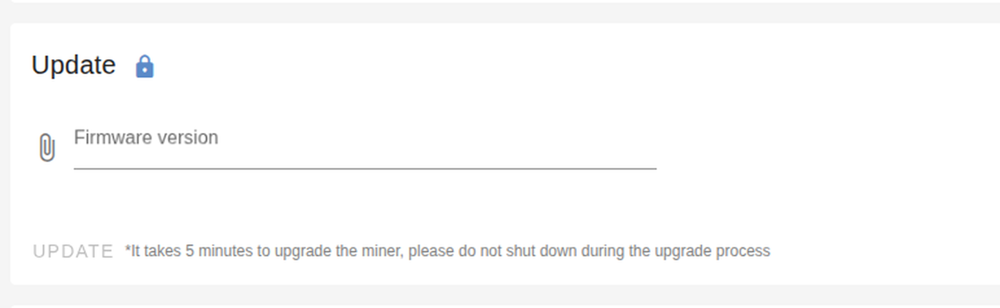
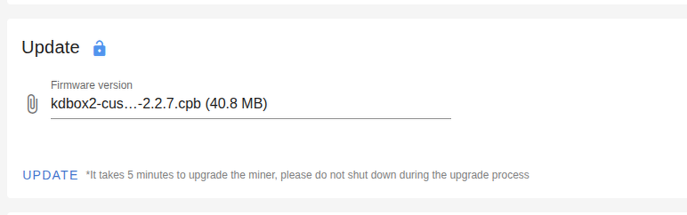

# Step by step: from a stock box to a root shell

This is the whole job, in order, for someone who has never done it. No prior knowledge of the
firmware needed.

Two kinds of work happen here:

- **On your PC** — building the image (steps 2–3). Once.
- **In a browser** — flashing the box (step 5). This is the part most people will do, and it
  is genuinely just a few clicks.

Total time: about 15 minutes of prep, then 3.5 minutes of watching a progress bar.

> Doing this on a box you own. It rewrites the firmware. Read
> [the warnings](../README.md#warnings) before you start, and keep the stock package you
> download in step 1 — it is your undo.

---

## What you need before starting

| | |
|---|---|
| The miner | on your LAN, reachable in a browser |
| A PC | Linux, or WSL. Needs `squashfs-tools`, `openssl`, `python3` |
| The stock package | `firmware-<model>-<version>.cpb` for **your** unit — see step 1 |
| Your SSH key | `~/.ssh/kdbox_rsa.pub` — **RSA**, see the note in step 2 |
| Signing | either the key + passphrase, or someone who holds it signs your build — see [signing-key.md](signing-key.md) |

---

## Step 1 — Look at your box

Open the miner in a browser and note two things:


**Firmware version** and **Hardware version**. You want `2.2.7` and `B2.CS.SA`
(`mcbversion MCB_V6_3_5`). The same information as JSON:

```sh
curl -s http://<miner-ip>/mcb/status
# {"hardware":"B2.CS.SA","model":"Goldshell-KDBoxⅡ","mcbversion":"MCB_V6_3_5","firmware":"2.2.7"}
```

Then download the **official stock package for that exact `mcbversion`** from Goldshell's
public archive: [github.com/goldshellminer/firmware](https://github.com/goldshellminer/firmware)
→ `KDA-Miner/Goldshell-KDBoxⅡ`. This is both the base of your build and your rollback file.
Keep it.

If your `mcbversion` is not `MCB_V6_3_5`, stop: the offsets in this repo are verified for that
version only. You would need to rebuild against your unit's own stock package.

## Step 2 — Change the rootfs

Unpack the stock package, then the rootfs inside it:

```sh
python3 scripts/build-cpb.py --unpack /tmp/kd /path/to/stock.cpb
unsquashfs -d /tmp/kd/root /tmp/kd/rootfs.sqfs
```

Make the changes that give you SSH. Note the key type first: the box's sshd is OpenSSH 6.4,
which predates ed25519 by one release, so an ed25519 key in `authorized_keys` will never log
you in. Generate RSA:

```sh
ssh-keygen -t rsa -b 4096 -f ~/.ssh/kdbox_rsa -C kdbox
```

```sh
# 1. your key, and only your key
mkdir -p /tmp/kd/root/root/.ssh
cp ~/.ssh/kdbox_rsa.pub /tmp/kd/root/root/.ssh/authorized_keys
chmod 700 /tmp/kd/root/root/.ssh
chmod 600 /tmp/kd/root/root/.ssh/authorized_keys

# 2. stop the management daemon killing sshd at boot
sed -i 's/killall sshd/echo "sshd stop disabled"/' /tmp/kd/root/etc/init.d/S50sshd

# 3. let root in, keys only
printf 'PermitRootLogin yes\nPasswordAuthentication no\nUseDNS no\n' >> /tmp/kd/root/etc/sshd_config

# 4. a marker so you can tell which image booted
echo "custom rootfs" > /tmp/kd/root/etc/kdbox-custom-fw

# 5. free up space — the rootfs region has under 1 KB of slack
rm -f /tmp/kd/root/root/yottamc/fonts/materialdesignicons-webfont.64d4cf64.eot
```

Repack it with the stock parameters:

```sh
mksquashfs /tmp/kd/root /tmp/kd/modified.sqfs \
    -comp gzip -b 131072 -no-xattrs -noappend -all-root -nopad -Xcompression-level 9
```

That `-all-root` matters: without it the image is owned by your user id and the daemons cannot
read their own config. Details and the failure modes are in
[ota-signed-flash.md](ota-signed-flash.md).

## Step 3 — Build the signed package

Everything needed for this step is in [signing-key.md](signing-key.md): a six-step extraction
from any official package (no root required to get the key), the passphrase, and how to verify
the result. You can also skip building entirely and ask someone to sign a build carrying
**your** public key.

```sh
export KD_FW_SIGNING_KEY=~/fw_cmpt.pem
export KD_FW_PASS='…'

python3 scripts/build-cpb.py \
    --stock /path/to/stock.cpb \
    --rootfs /tmp/kd/modified.sqfs \
    --pubkey ~/.ssh/kdbox_rsa.pub \
    --out kdbox2-custom.cpb
```

The script signs the image, checks the signature against the vendor's public key, and refuses
to write anything if a check fails. You want to see `ALL CHECKS PASSED`.

## Step 4 — Get to the Update card

Back to the browser. **System** in the menu, then **UNLOCK** (top right).


The admin password is `123456789` on a box that has never been configured. Unlocking turns the
buttons on; it does not flash anything.

Scroll down to **Update**. Locked, it looks like this:



Unlocked but with no file chosen, `UPDATE` is still greyed out:


## Step 5 — Flash it (the part everyone does in the GUI)

Click the **Firmware version** field and pick your `kdbox2-custom.cpb`. The chooser only shows
`.tgz` and `.cpb`, which is all this firmware accepts.



**Check the name and the size in that field before you click.** The chooser remembers your
last file, and the stock package is right next to your build in most people's downloads.

Then click **UPDATE**.

- There is **no confirmation dialog**. The click is the confirmation.
- The card shows `Uploading firmware to miner…`, then `Firmware is being verified by miner…`,
  then `Miner is in updating progress…`.
- The page will stop responding and the box will vanish from the network for roughly two and a
  half minutes. Total: about **3.5 minutes**.
- You may see **"Update process terminated. Please choose the officially issued update
  package."** — on a successful flash this is normal and misleading: the socket died because
  the daemon killed userspace to write flash. Do **not** upload again. Wait, reload, and check
  the firmware version.

Equivalent from a shell:

```sh
scripts/flash-ota.sh <miner-ip> kdbox2-custom.cpb
```

It checks the version, logs in, uploads, and watches for the box to come back. `KD_DRY_RUN=1`
stops after login if you want to see the request first.

> **If the upload refuses** — on some boxes (observed after a unit has run this image for a
> while) every upload, browser or `curl`, fails the same way: the daemon writes the payload
> split across two files at a fixed offset and never flashes. Re-uploading does not help.
> The reliable fallback, if you already have a root shell on that unit, is writing the
> repacked rootfs straight to the partition — see
> [ota-signed-flash.md](ota-signed-flash.md), section *"When the uploader refuses"*.

## Step 6 — Log in

```sh
ssh -i ~/.ssh/kdbox_rsa \
    -o PubkeyAcceptedKeyTypes=+ssh-rsa -o HostKeyAlgorithms=+ssh-rsa \
    root@<miner-ip> 'id; cat /etc/kdbox-custom-fw'
```

```
uid=0(root) gid=0(root) groups=0(root),10(wheel)
custom rootfs
```

Those two `-o` flags are not optional. The box runs OpenSSH 6.4: RSA keys only, no ed25519, no
modern key exchange. Without them you get `no matching host key type` or a refused connection
and conclude, wrongly, that the flash failed. The same applies to the key itself — if
`authorized_keys` in the image holds an ed25519 key, no flag can make this sshd accept it.

Then reboot once to be sure it is permanent:

```sh
ssh … 'sync; reboot -f'
# wait for http://<miner-ip>/mcb/status to answer again, then repeat the check above
```

## Step 7 — Put the box back to work

The flash rewrites the config partition, so:

- **Re-add your mining pool** (the web UI's pool page, or `PUT /mcb/newpool`).
- **Change the admin password** — it is `123456789` again until you do.
- **Turn WiFi off** if the miner is wired. Stock 2.2.7 runs an *open* access point
  (`hostapd`, SSID `Goldshell-<suffix>`, no encryption) on `192.168.77.1/24`, so anyone nearby
  can reach the web UI — and the stock toggle ignores the flag. This image fixes that: the
  toggle (System → WLAN, or `curl -X PUT -d '{"enable":false}' http://<ip>/mcb/wifisetting`)
  takes effect within a few seconds and survives reboots.
- Keep the box off the open internet. `/mcb/wifisetting` answers without authentication and
  exposes the scan list and WiFi state — reconnaissance, not credentials, but free.

---

## If something goes wrong

| what you see | what it means | do this |
|---|---|---|
| Clicked UPDATE, box stayed up, firmware unchanged, log says `Minerd start !!!` | the package was malformed — almost always a single-member `.cpb` | rebuild with `build-cpb.py`; do not hand-roll the container |
| `UPDATE` stays greyed out | your browser is still locked, or no file is selected | UNLOCK first, then pick the file |
| Login says `Permission denied (publickey)` | the key is not in the image, is not RSA, or the image was built with a different one | the image trusts exactly `authorized_keys` from build time, and this sshd has no ed25519 — rebuild with `~/.ssh/kdbox_rsa.pub` |
| `no matching host key type` | missing the legacy flags | add `-o PubkeyAcceptedKeyTypes=+ssh-rsa -o HostKeyAlgorithms=+ssh-rsa` |
| Box never comes back on the network | the rootfs did not mount | this needs physical access to the board's console header; re-flashing the stock package through the web UI is only possible if the box boots far enough to serve it |

More failure modes (mining, WiFi, the flaky uploader) live in
**[troubleshooting.md](troubleshooting.md)**; deeper detail, including the container layout
and every verification gate, is in [ota-signed-flash.md](ota-signed-flash.md).
